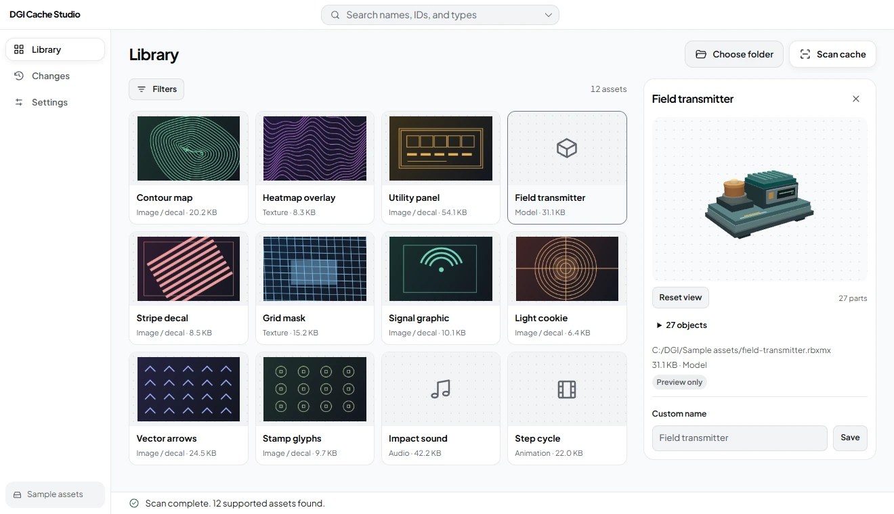
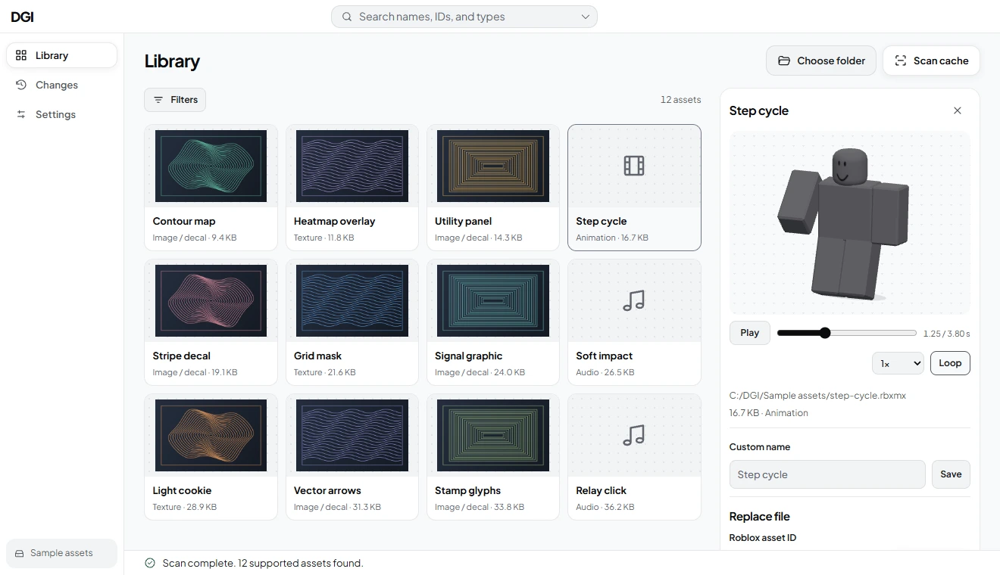
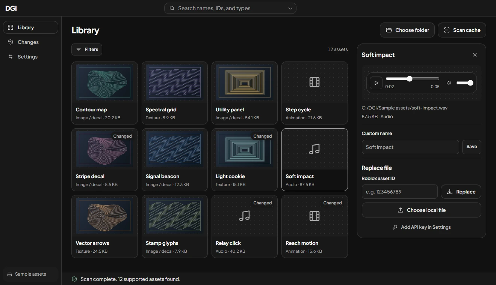
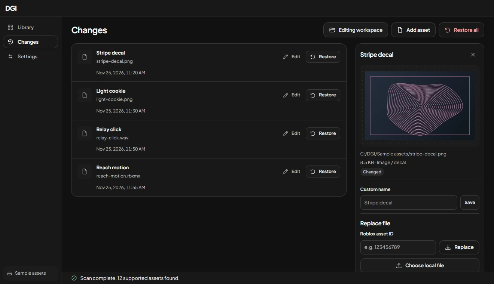

# DGI Cache Studio

A Windows desktop app for browsing your local Roblox cache, previewing assets, and managing replacements with backups. DGI uses a TypeScript interface with Tauri and handles local files in Rust.

[Website](https://dgi.nok02.cc/) · [Windows releases](https://github.com/YVL113/dgi/releases/latest)

## Screenshots

| Asset Library | R6 animation |
| --- | --- |
|  |  |
| **Audio playback** | **Changes and restore** |
|  |  |

## Install

1. Open the latest GitHub release using an account that has access to this repository.
2. Download and run the `DGI_*_x64-setup.exe` installer. The release also includes its SHA-256 checksum.

DGI uses Microsoft Edge WebView2. 3D previews require WebGL 2, and audio playback depends on the WebView's codecs.

## Browse and edit assets

- **Library** automatically looks for the Roblox cache on Windows and checks for new files every three seconds. Use **Scan cache** for a full rescan with progress, or **Choose folder** for a local export. **Settings → Find Roblox cache** returns to automatic discovery.
- **Search and filters** narrow the Library by name, known asset ID, or type. Use the arrow keys and Enter to open a search result. Library and **Changes → Add asset** share filter preferences. Custom names can be saved or reset in the inspector.
- **Previews** include common image formats and supported KTX2 textures, audio, meshes, and Roblox KeyframeSequences. Rotate or zoom meshes, seek within audio, and scrub animations on an R6 or R15 rig with loop and speed controls. Some stored Roblox objects only contain references or metadata.
- **Replace** a supported image, audio clip, or KeyframeSequence from a local file or permitted Roblox asset ID. The editing workspace holds independent copies and imported files. Use **Apply to Roblox cache** to write an edited copy back when DGI can identify a unique original. Close Roblox Player before applying or restoring a cache replacement.
- **Restore** and **Restore all** are available in Changes. DGI preserves the first original across repeated replacements and restarts, verifies writes, and reports conflicts when the cached bytes change underneath an edit. **Clear cache** removes cached assets and responses after confirmation while preserving active replacements, backups, and workspace files.

DGI can preview assets Roblox has cached locally. Roblox may evict entries, and some assets are never written to disk. KTX2 textures are preview-only at the source and can be converted to PNG in the editing workspace. Replacement files are limited to 32 MiB.

### Roblox downloads

Local previews work without an API key. Downloads require a Roblox Open Cloud key with Asset Delivery access. DGI checks environment variables such as `ROBLOX_OPEN_CLOUD_API_KEY`, `ROBLOX_API_KEY`, and `RBX_API_KEY`, including Windows user and system variables. **Settings → Roblox downloads** can recheck the environment or accept a key for the current session. [Roblox API keys](https://create.roblox.com/docs/cloud/auth/api-keys) · [Asset Delivery](https://create.roblox.com/docs/cloud/reference/features/assets)

## Develop

Install Node.js, stable Rust, and the [Tauri platform prerequisites](https://v2.tauri.app/start/prerequisites/).

```sh
npm ci
npm run tauri dev
```

```sh
npm run build
cargo test --locked --manifest-path src-tauri/Cargo.toml
npm run tauri build
```

The Windows title bar uses [Tauri Window Controls](https://github.com/insd47/tauri-plugin-window-controls). Three.js renders animation and mesh previews. On Windows, DGI requests the Vulkan backend through ANGLE in WebView2.

<details>
<summary>Use local R6 and R15 rig meshes</summary>

After `npm ci`, import the R6 FBX archive first, followed by the R15 OBJ archive. The R15 importer reuses the face texture from the installed R6 pack. Both imports preserve the other rig and back up an existing pack before its first update. Restart DGI to load the new meshes.

```powershell
npm run rig:install -- "C:\path\to\roblox-r6-rigged.zip"
npm run rig:install:r15 -- "C:\path\to\roblox-r15-rigged-obj-file.zip"
```

DGI reads `studio-rig-meshes.json` from `%LOCALAPPDATA%\com.dgi.desktop`. The version 1 schema accepts `R6` and `R15` maps from joint names to `vertices` and `triangles`. Vertices use local stud coordinates and triangle indices are zero-based. A local export can also define `r6Rig` or `r15Rig` entries for each part using `parent`, `size`, `c0`, and `c1`. Each CFrame has three position values followed by nine row-major rotation values. Parts can provide `color`, and a head can include `uv` with a top-left origin and a Base64 `texturePng` or `frontDecalPng`.

</details>

The [website source and deploy instructions](site/README.md) are in `site/`. See [AGENTS.md](AGENTS.md) for the shared Ghost Acrylic design system.

### Publish a release

Push a version tag such as `v0.1.0` on `master` that matches the version in `src-tauri/tauri.conf.json`. GitHub Actions checks the tagged history and the compiled frontend for secrets, verifies the Windows installer payload, and publishes the installer and SHA-256 checksum on GitHub Releases. Branch and pull request builds are available as Actions artifacts.

DGI Cache Studio is an independent desktop utility unaffiliated with Roblox Corporation.
